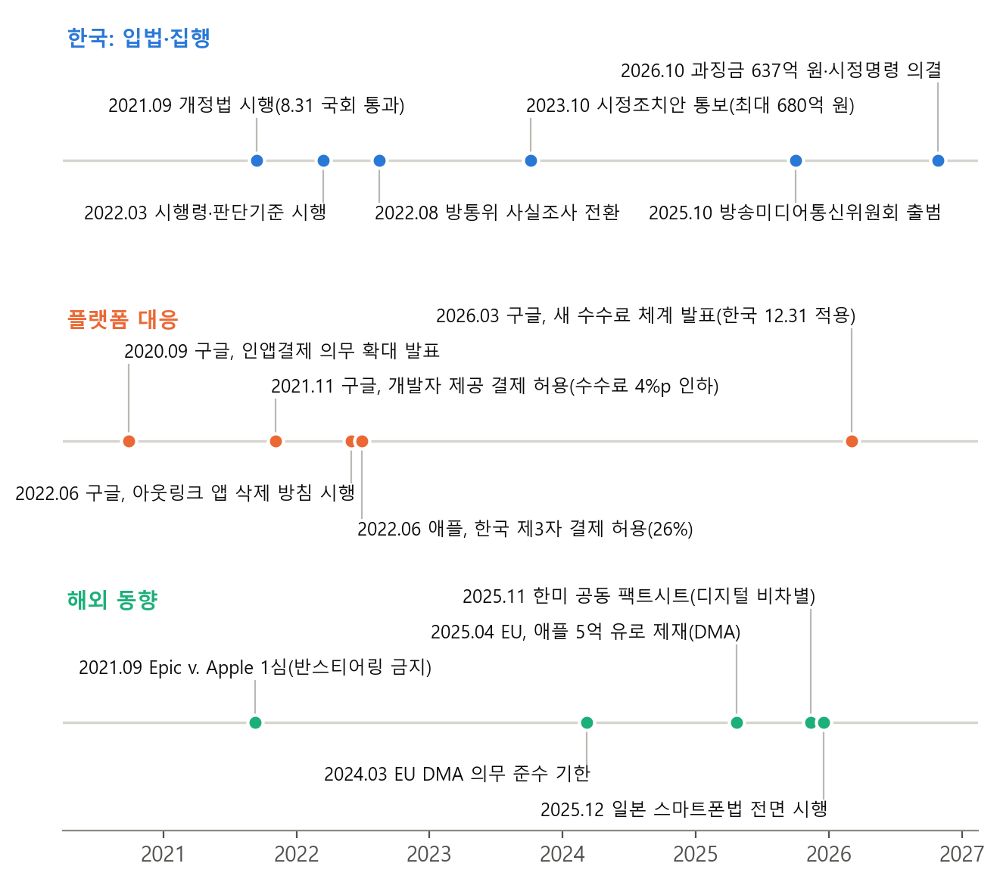
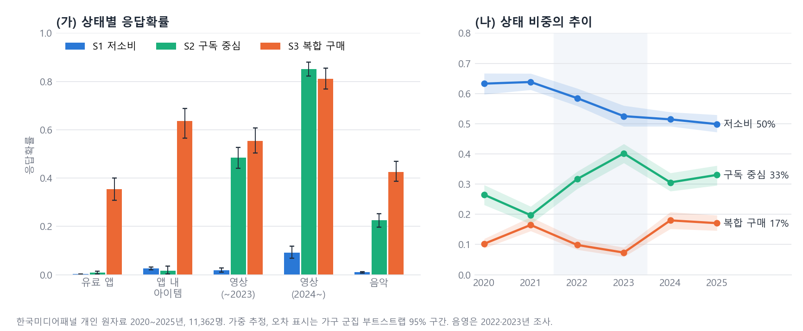
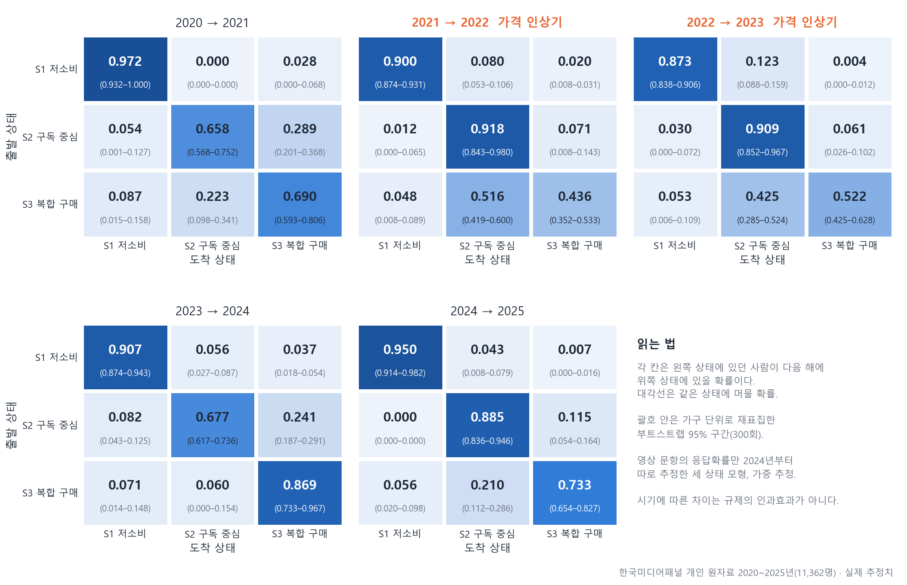
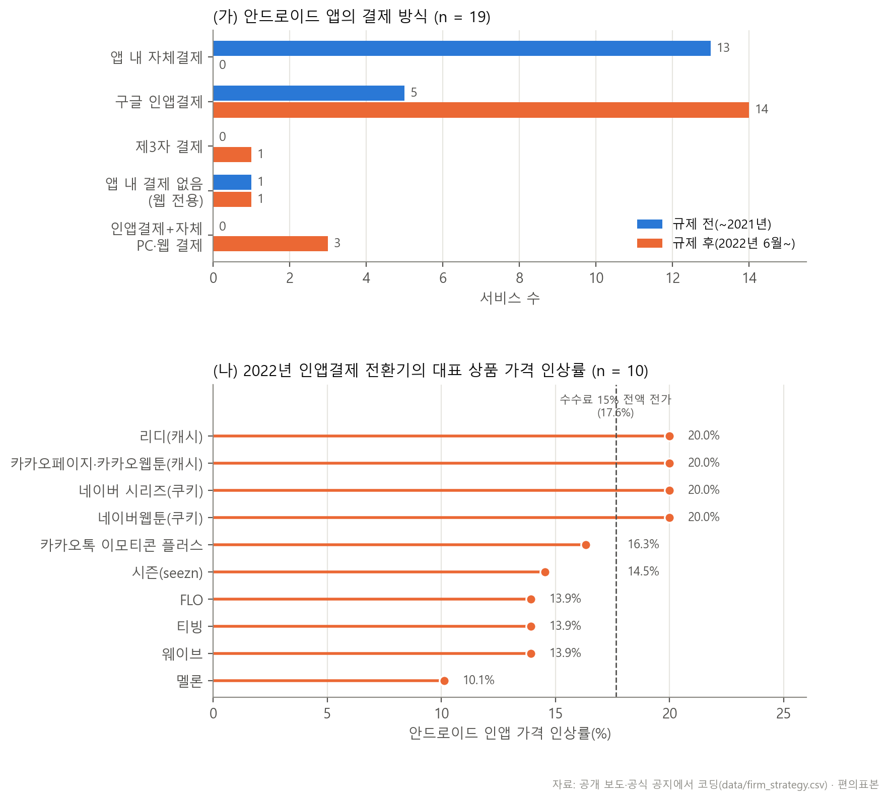

# 한국 인앱결제 강제금지 규제와 디지털 콘텐츠 소비 상태의 전이

2021년 한국은 세계에서 처음으로 앱마켓 사업자가 특정 결제방식을 강제하지 못하게 하는 법을 시행하였다. 이 저장소는 그 뒤 **이용자의 유료 디지털 콘텐츠 소비가 어떻게 달라졌는지**를 KISDI 한국미디어패널 개인 원자료(2020~2025년, 11,362명)의 잠재전이분석(Latent Transition Analysis, LTA)으로 살펴본 연구의 논문과 코드, 결과를 담고 있다.

[](https://iap-lta.streamlit.app)

**바로 가기** · [결과 대시보드(웹)](https://iap-lta.streamlit.app) · [논문 PDF(58쪽)](paper/한국_인앱결제_LTA_논문_20261111.pdf) · [코드와 파일 안내](CODEBOOK.md)

## 한눈에 보기

- 이용자의 유료 콘텐츠 소비는 **세 가지 상태**로 요약된다. 거의 사지 않는 *저소비*, 영상·음악 구독이 중심인 *구독 중심*, 구독에 더해 앱과 앱 내 아이템까지 사는 *복합 구매*이다.
- 가격 인상이 있었던 2021~2023년에 **복합 구매 상태에서 벗어나는 사람이 크게 늘었다.** 복합 구매에 머무를 확률은 0.69에서 0.44로 떨어졌고, 그만큼 구독 중심 상태로 옮겨 갔다.
- 그러나 이것을 **가격 인상의 효과라고 말할 수는 없다.** 값이 오른 영상·음원의 유료 이용은 줄지 않았고, 가격 인상에 더 많이 노출된 사람이 더 많이 이탈한 것도 아니었다.
- 공급 쪽에서는 콘텐츠 사업자가 플랫폼의 결제를 받아들이고 그 비용을 가격에 얹었다. 법이 겨냥한 결제 선택권은 형식적으로만 달성되었다.

## 1. 배경: 법은 시행되었지만 제재는 5년 뒤에 왔다

구글은 2020년 9월, 디지털 재화를 파는 모든 앱에 자사 결제(수수료 최대 30%)를 쓰게 하겠다고 발표하였다. 이에 대응해 국회는 2021년 8월 「전기통신사업법」을 개정하였고, 9월 14일부터 앱마켓 사업자가 특정 결제방식을 강제하는 행위가 금지되었다.

플랫폼의 대응은 법의 문언을 충족하는 최소한에 그쳤다. 구글과 애플은 제3자 결제를 허용하였지만 수수료를 26%로 정하였고, 결제대행 수수료를 더하면 인앱결제보다 싸지 않았다. 구글은 2022년 6월부터 앱 밖 결제로 이어지는 링크를 둔 앱을 삭제하기 시작하였다. 그러자 그동안 자체 결제를 쓰던 영상·음원·웹툰 서비스들이 인앱결제를 받아들이면서 안드로이드 앱 안의 가격을 10~20% 올렸다.

규제 당국의 집행은 더뎠다. 방송통신위원회는 2022년 8월 사실조사에 들어가 2023년 10월 시정조치안(과징금 최대 680억 원)을 통보하였지만, 과징금 의결은 법 시행 5년 뒤인 2026년 10월 28일에야 이루어졌다(구글 429억 원, 애플 208.1억 원).



## 2. 연구 질문과 연구명제

법은 앱마켓 사업자와 콘텐츠 사업자 사이의 수수료 배분을 겨냥하였다. 그런데 부담이 가격으로 넘어갔다면, 그 종착점은 이용자이다. 이 연구는 다음을 묻는다.

> 이용자의 유료 디지털 콘텐츠 소비는 몇 가지 상태로 나뉘며, 규제와 가격 인상을 전후해 상태 사이의 이동은 어떻게 달라졌는가?

여기에 공급 쪽에 관한 두 연구명제를 함께 검토한다.

- **연구명제 1.** 인앱결제 강제 금지 규제 시행 전후 앱마켓 관련 기업들의 사업 및 결제전략 유형에 변화가 나타날 것이다.
- **연구명제 2.** 규제 시행 이후 플랫폼 사업자의 전략적 대응에 따라 규제의 실질적 효과는 당초 정책목표와 다르게 나타날 수 있다.

## 3. 자료

| 자료 | 내용 |
|---|---|
| KISDI 한국미디어패널 개인 원자료 | 2020~2025년 6개 연도. 11,362명, 4,472가구, 개인-연도 57,258건. 해마다 같은 사람을 다시 조사하는 패널이다 |
| 소비 지표 4개 | 유료 앱 구입, 앱 내 아이템 구입, 영상(OTT) 유료 이용, 음악 유료 이용. 각각 "했다/안 했다"의 이분 지표 |
| 가격 인상 노출 지수 | 개인이 값이 오른 분야(영상, 음원, 웹툰)를 얼마나 이용했는지에 2022년 분야별 인앱 가격 인상률을 곱해 더한 값 |
| 사업자 전략 자료 | 국내 주요 콘텐츠 서비스 22개와 앱마켓 사업자 4개의 규제 전후 결제 방식과 가격. 공식 공지와 보도에서 코딩 |
| 정책목표별 결과 지표 | 수수료, 시장 점유율, 실태조사, 선행연구 등 48건. 출처 URL 수록 |

개인 원자료는 KISDI 미디어통계포털에서 이용 동의를 거쳐 받는 자료이므로 **이 저장소에는 들어 있지 않다.** 여기에는 그 자료로 계산한 집계 결과만 있다.

## 4. 방법

**잠재전이분석(LTA)** 은 겉으로 보이는 여러 응답 뒤에 몇 개의 숨은 상태가 있다고 보고, 사람들이 해마다 그 상태 사이를 어떻게 옮겨 다니는지를 추정하는 방법이다. 네 가지 지표를 하나씩 따로 보면 "구독은 하지만 앱은 사지 않는 사람"과 "둘 다 하는 사람"이 섞여 버리는데, LTA는 이들을 서로 다른 상태로 나누고 한 상태에서 다른 상태로 옮겨 갈 확률(전이확률)을 구간마다 구한다.

- **상태 수.** 상태를 1~5개로 바꿔 가며 적합도(BIC)와 가장 작은 상태의 크기를 비교해 세 상태를 택하였다.
- **측정 단절의 처리.** 2024년에 영상 유료 이용 비율이 한 해에 26.5%에서 43.9%로 뛰어 조사 측정이 달라진 것으로 보인다. 그래서 영상 문항만 2024년부터 응답확률을 따로 추정하였다(부분 측정불변).
- **불확실성.** 조사 가중치를 반영하였고, 신뢰구간은 가구 단위 부트스트랩 300회로 구하였다.
- **모형에 기대지 않은 확인.** 두 해 자료를 직접 이어 "올해 산 사람이 이듬해에도 샀는가"(지속률)를 따로 계산하였다.
- **가격 인상 노출의 효과.** 노출 지수가 높은 사람이 가격 인상기에 더 많이 이탈했는지를 로지스틱 회귀(가구 군집 표준오차)로 검정하였다.
- **사전 검증.** 원자료를 얻기 전에 같은 표본 크기의 모의패널로 추정 엔진을 검증하였다. 파이썬과 R의 독립 구현, R 패키지 LMest가 같은 로그우도에 도달하였고, 몬테카를로 실험으로 검정력을 확인하였다.

## 5. 주요 결과

### 5.1 세 가지 소비 상태

각 상태에 속한 사람이 해당 항목을 유료로 이용할 확률은 다음과 같다.

| 지표 | 저소비 | 구독 중심 | 복합 구매 |
|---|---:|---:|---:|
| 유료 앱 구입 | 0% | 1% | 35% |
| 앱 내 아이템 구입 | 3% | 2% | 64% |
| 영상 유료 이용(2020~2023) | 2% | 48% | 55% |
| 영상 유료 이용(2024~2025) | 9% | 85% | 81% |
| 음악 유료 이용 | 1% | 23% | 42% |

구독 중심과 복합 구매를 가르는 것은 **앱과 앱 내 아이템을 사는가**이다. 영상과 음악 구독은 두 상태 모두에서 흔하다.

### 5.2 상태의 비중은 어떻게 변했나

저소비는 63.3%(2020년)에서 49.9%(2025년)로 줄었고, 구독 중심은 26.5%에서 33.1%로 늘었다. 복합 구매는 10.2 → 16.5 → 9.9 → 7.3 → 18.0 → 17.1%로, 2021년에 올랐다가 2022~2023년에 내려가고 2024년에 다시 올랐다.



### 5.3 복합 구매 상태에서의 이동

복합 구매 상태에 있던 사람이 이듬해 어디에 있었는지를 구간별로 보면 다음과 같다.

| 구간 | 복합 구매 유지 | → 구독 중심 | 비고 |
|---|---:|---:|---|
| 2020 → 2021 | 0.69 | 0.22 | 가격 인상 이전 |
| 2021 → 2022 | 0.44 | 0.52 | 가격 인상기 |
| 2022 → 2023 | 0.52 | 0.43 | 가격 인상기 |
| 2023 → 2024 | 0.87 | 0.06 | 이후 |
| 2024 → 2025 | 0.73 | 0.21 | 이후 |

가격 인상기의 "복합 구매 → 구독 중심" 이동확률은 그 이전보다 **0.247 높았다**(가구 부트스트랩 95% 구간 0.129~0.340). 사람들은 유료 소비를 그만둔 것이 아니라, 구독은 유지하면서 앱과 아이템 구입을 멈추는 쪽으로 움직였다.



### 5.4 모형 없이 본 지속률

모형을 거치지 않고 계산해도 같은 흐름이 보인다. 앱 내 아이템을 산 사람이 이듬해에도 산 비율은 39.7 → 23.0 → 27.9 → 44.5 → 47.5%로, 가격 인상기에 뚜렷이 낮았다. 반면 음악 유료 이용의 지속률은 41~47% 사이에서 거의 움직이지 않았다.

### 5.5 가격 인상에 더 많이 노출된 사람이 더 많이 이탈했는가

그렇지 않았다. 노출 지수와 가격 인상기의 상호작용은 0.034(표준오차 0.156, p = 0.83)로 0과 구별되지 않았다. 가격 인상이 이탈의 원인이었다면 값이 오른 분야를 많이 쓰던 사람일수록 더 많이 이탈했어야 한다.

### 5.6 연구명제 1: 사업자의 결제 전략은 바뀌었다

규제 전후의 결제 방식을 모두 확인한 19개 서비스 가운데 **16개가 결제 방식을 바꾸었다.** 대부분 앱 안의 자체 결제에서 플랫폼 인앱결제로 옮겼다. 2022년에 인앱 가격이 확인된 10개 서비스는 **모두 값을 올렸고**, 인상률은 10.1~20.0%(중위 15.4%)였다. 수수료 15%를 전액 가격에 얹을 때의 인상률 17.6%에 가까운 수준이다. 법이 열어 준 제3자 결제를 도입한 것으로 확인된 서비스는 1개(FLO)뿐이었다.



### 5.7 연구명제 2: 정책목표와 실제 결과는 달랐다

| 정책목표 | 관찰된 결과 | 판정 |
|---|---|---|
| 결제방식 선택권 보장 | 제3자 결제는 허용되었으나 수수료 26%에 결제대행 수수료가 더해져 인앱결제보다 싸지 않음. 도입 사례 1개 | 형식적 달성, 실질 미달 |
| 개발사의 수수료 부담 완화 | 비게임 앱이 자체 결제에서 수수료 15~30%의 플랫폼 결제로 이동. 개발사의 70.4%가 과도한 수수료를 최대 문제로 지목 | 역행 |
| 이용자 후생 | 2022년 인앱 가격 10.1~20.0% 인상. 의원실 추정 소비자 추가 부담 연 최대 2,300억 원 | 역행 |
| 집행의 실효성 | 사실조사(2022. 8.) → 시정조치안(2023. 10.) → 의결(2026. 10.). 법 시행 후 5년 | 지연, 제한적 |
| 공급 측 시장 성과 | 앱 다운로드와 매출에 유의한 변화 없음(Chang & Miller, 2025) | 변화 없음 |

판정은 이 연구의 해석이다.

## 6. 해석: 왜 가격 인상의 효과라고 단정할 수 없는가

복합 구매 상태에서의 이탈이 가격 인상기에 몰린 것은 사실이다. 그러나 네 가지 이유에서 이를 가격 인상의 효과로 읽을 수 없다.

1. **값이 오른 것은 줄지 않았다.** 가격이 오른 영상과 음원의 유료 이용은 줄지 않았다(영상 18.5% → 26.5%, 2021~2023년). 줄어든 것은 유료 앱과 앱 내 아이템 구입이다.
2. **2021년은 코로나 시기의 고점이었다.** 2021년에 앱 내 아이템 구입이 7.8%에서 13.4%로 뛰었다가 되돌아왔다. 2021→2023년의 이탈은 일시적으로 늘었던 소비가 제자리로 돌아간 것일 수 있다.
3. **2024년에는 조사 측정이 달라졌다.** 2024년의 반등에는 측정 변화가 섞여 있어, 그 전후를 그대로 비교하기 어렵다.
4. **노출이 이탈을 예측하지 못했다.** 5.5절의 결과이다.

종합하면, 가격 인상의 부담은 이용을 그만두게 하기보다 **같은 서비스에 더 많은 돈을 내는 형태로 이용자에게 넘어갔을 가능성**이 크다. 시기에 따른 전이의 차이를 규제의 인과효과로 읽어서는 안 된다.

## 7. 한계

- 한국미디어패널은 결제 경로(앱 안에서 샀는지 웹에서 샀는지)와 운영체제별 결제를 묻지 않는다. 인앱 가격 인상에 실제로 노출되었는지는 간접적으로만 잴 수 있다.
- 세 상태 모형은 근사이다. 모형이 함의하는 연도별 지표 비율은 관측값과 평균 1.0%포인트, 최대 2.2%포인트 어긋난다.
- 사업자 전략 자료는 보도된 서비스 중심의 편의표본이다. 웨이브와 FLO는 인상 시점이나 가격에 관한 보도가 엇갈린다.
- 2026년 과징금의 상한 적용 전 산출액은 한 매체의 보도에만 있고 공식 보도자료에는 없다.
- 개인별 공변량을 잠재상태 모형에 직접 넣은 분석은 원자료에서 추정이 불안정하여 결론에 쓰지 않았다.

## 8. 결과는 어떻게 검증했나

| 검증 | 결과 | 파일 |
|---|---|---|
| 모든 분석을 처음부터 다시 실행해 저장값과 대조 | 숫자 47,505개. 원자료 분석은 차이 0건. 공변량 모의 분석만 소수 4~5째 자리에서 달라 재실행값으로 교체하였고, 한 번 더 돌려 완전히 같음을 확인 | `outputs/rerun_comparison.csv` |
| 논문에 적힌 수치의 전수 점검 | 98개 항목 모두 일치 | `outputs/paper_audit.csv` |
| 본문에 직접 적은 사실을 출처에서 재확인 | 41건 중 확인 38, 불일치 1(수정), 확인 불가 2(삭제) | `outputs/fact_check.csv` |
| 점검 도구 자체의 시험 | 일부러 넣은 오류 10건을 모두 검출 | `outputs/audit_selftest.csv` |
| 원자료 결과의 재검증 | 공표값 대조, 재추정, 우도 전수 열거 등 13개 검사 일치 | `outputs/real_verification.csv` |

## 결과 대시보드

분석 결과를 탭으로 나누어 볼 수 있는 Streamlit 대시보드이다. 설치 없이 웹에서 바로 볼 수 있다.

**👉 <https://iap-lta.streamlit.app>**

저장된 집계 결과만 읽으므로 개인 원자료는 들어 있지 않다. 한동안 접속이 없으면 앱이 잠들어 있을 수 있는데, 화면의 깨우기 버튼을 누르면 1분 안에 다시 켜진다.

| 탭 | 내용 |
|---|---|
| 요약 | 표본 규모, 핵심 결과, 상태 비중의 추이, 정책 연표, 논문 PDF 내려받기 |
| 유료 이용 추이 | 네 지표의 연도별 비율, 지속률과 진입률 |
| 잠재상태 | 상태별 응답확률, 상태 수의 선택, 민감도 분석 |
| 전이확률 | 구간별 전이행렬, 출발 상태별 흐름, 가격 인상기와 전후의 차이 |
| 가격 인상과 노출 | 서비스별 인상률, 결제 방식의 변화, 노출 지수 회귀 |
| 모의실험 | 검정력 곡선, 공변량 모형의 모의실험 |
| 검증 | 전수 점검, 재실행 대조, 출처 재확인 |

**내 컴퓨터에서 실행**

```bash
git clone https://github.com/mw48795472/IAP_LTA.git
cd IAP_LTA
pip install -r requirements.txt
streamlit run app.py
```

웹 버전은 Streamlit Community Cloud에서 이 저장소의 `main` 브랜치 `app.py`를 그대로 실행한 것이다. `main`에 푸시하면 자동으로 다시 배포된다.

## 저장소 구성

| 경로 | 내용 |
|---|---|
| `paper/` | 논문 PDF |
| `app.py`, `requirements.txt` | 결과 대시보드 |
| `code/` | 추정 엔진(파이썬·R), 분석 스크립트 01~16, 테스트, 논문 빌드 도구 |
| `data/` | 정책 연표, 공표 집계치, 사업자 전략 자료, 모의패널 |
| `outputs/` | 저장된 분석 결과와 검증 기록 |
| `figures/` | 논문에 쓴 그림 |
| [`CODEBOOK.md`](CODEBOOK.md) | 스크립트별 설명, 재현 순서, 자료 출처의 자세한 안내 |

**재현하려면.** 공개자료와 모의패널을 쓰는 분석(`code/01`~`06`)은 바로 실행된다. 원자료 분석(`code/07`~`13`)은 KISDI 미디어통계포털에서 한국미디어패널 개인 CSV(2020~2025년)를 받아 `data/private/raw_kisdi/`에 둔 뒤 `python code/07_build_real_panel.py`, `python code/08_real_data_lta.py` 순으로 실행한다. 자세한 순서는 [CODEBOOK.md](CODEBOOK.md)에 있다.

## 자료 출처

- 정보통신정책연구원(KISDI) 한국미디어패널조사 2020~2025년 개인 원자료와 연도별 보고서
- 방송통신위원회·방송미디어통신위원회 보도자료, 앱마켓 실태조사
- 구글·애플의 공식 공지와 국내 언론 보도(`data/policy_events.csv`, `data/firm_strategy.csv`, `data/policy_goal_outcome_evidence.csv`에 출처 URL 수록)
- Chang, B., & Miller, K. (2025). Early evidence on the effects of open mobile in-app payment systems from South Korea. *Journal of Competition Law & Economics*.
